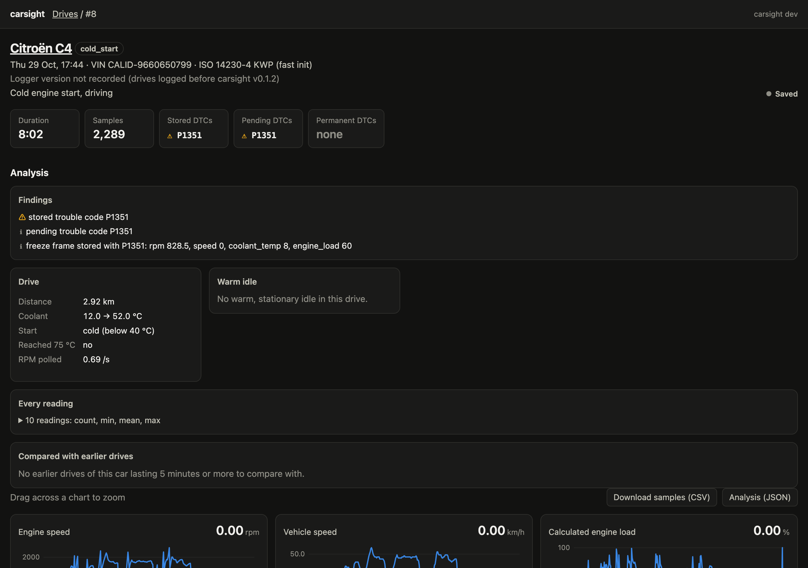
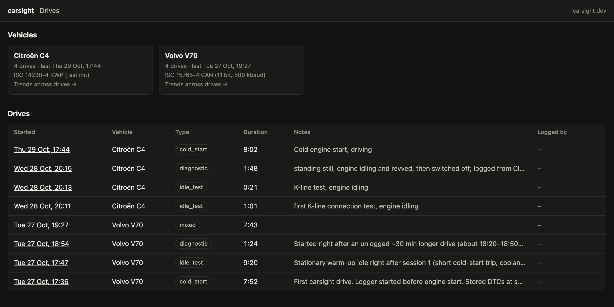
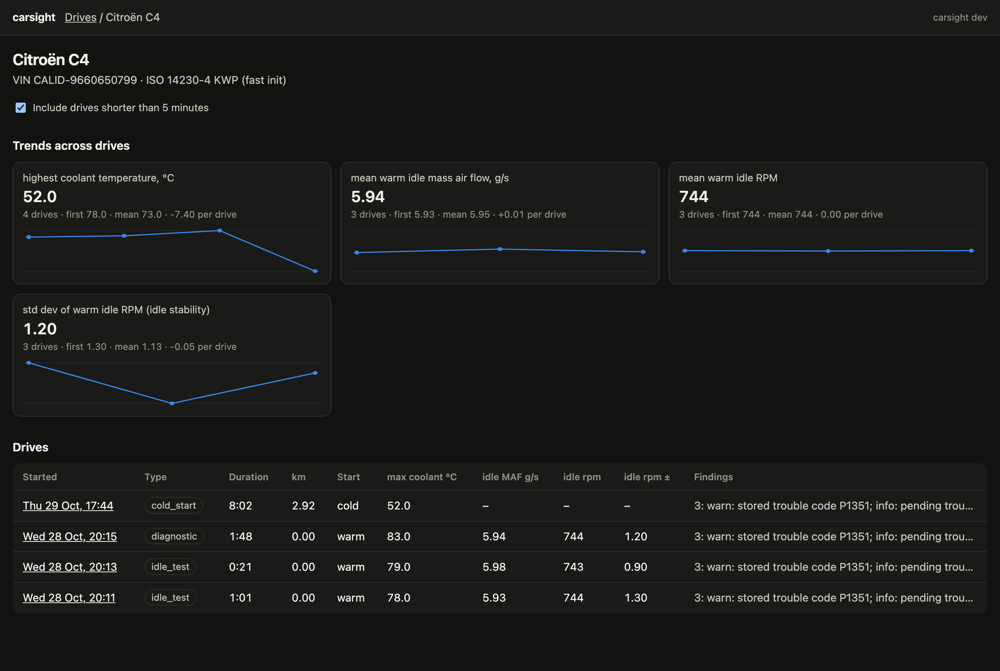
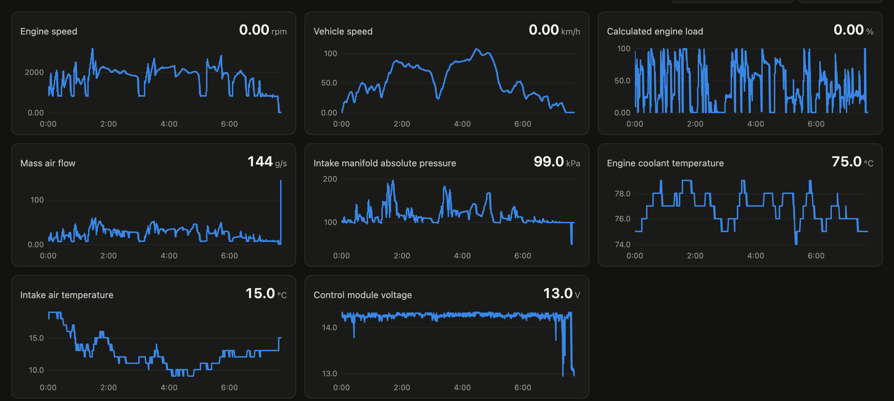
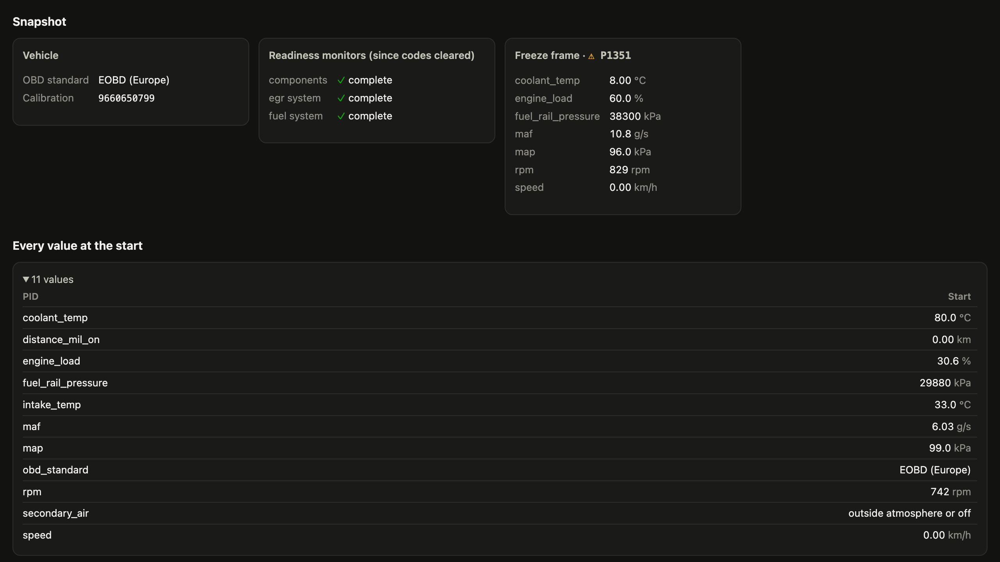

# carsight

Read live data from our cars over OBD-II, store it, and use AI to analyse it: spot anomalies, track engine health over time, and explain fault codes in plain language.



## What it does

- **Logs every standard OBD-II reading the car supports** through a USB ELM327 adapter, one session per drive, into a local SQLite database.
- **Reads the car's own diagnostics** at the start and end of each drive: trouble codes (stored, pending, permanent), the freeze frame, readiness monitors, ECU calibration IDs and on-board test results such as misfires per cylinder.
- **Analyses each drive**: warm-up, warm idle, fuel trims, charging voltage, O2 activity, rule-based findings, and a comparison with the same car's earlier drives.
- **Shows it all in a local dashboard**: live charts while you drive, replay of saved drives, the analysis, and trends per car.
- **Lets an AI assistant do the diagnosis** over [MCP](https://modelcontextprotocol.io): Claude (or any MCP client) can start and stop drives, read the analysis, pull raw samples and explain what it means.
- **Records which carsight version and adapter logged each drive**, so you can tell which software collected the data.

## Screenshots

All taken from real drives of the two cars below (the Volvo's VIN is masked).

| | |
|---|---|
| **Drives and vehicles.** Every logged drive, its type, notes and the carsight version that logged it.  | **Trends per car.** Key figures across drives (coolant, idle RPM and stability, airflow, fuel trims, voltage) with the change per drive.  |
| **Every reading, charted.** A 7½-minute Volvo drive polled at 11 readings a second. Drag to zoom; the crosshair is shared across charts.  | **What the car reported.** Vehicle and ECU information, readiness monitors, the freeze frame stored with a fault code, and every value at the start and end.  |

## Quick start

1. **Install** (Go 1.27+):

   ```bash
   go install github.com/jnszkr/carsight/cmd/carsight@latest
   carsight version
   ```

2. **Connect**: plug the ELM327 adapter into the laptop and the car's OBD-II port, turn the ignition on, and check the link:

   ```bash
   carsight scan
   ```

   No car nearby? Add `-port sim:volvo` (or `sim:citroen`) to any car command to use the built-in simulator.

3. **Log a drive**: start the engine, then

   ```bash
   carsight log -name "Volvo V70" -type commute
   ```

   It prints a dashboard link with live charts. Press Ctrl-C at the end of the drive.

4. **Look at it**:

   ```bash
   carsight dashboard     # http://127.0.0.1:7341: drives, analysis, trends
   carsight report        # Markdown report on the latest drive
   ```

5. **Ask an AI about it**: add carsight to Claude ([below](#add-carsight-to-claude)) and ask "how did my last drive go?". Claude can also start and stop the logging for you.

## Goals

1. **Log** live engine data from the OBD-II port to local storage while driving.
2. **Store** every drive as a structured session (car, start/end time, samples, DTCs).
3. **Analyse** sessions with an AI assistant of your choice, over MCP: summarise a drive, compare it against the car's baseline, flag anything unusual, and explain trouble codes.
4. **Track trends** across many drives (e.g. fuel trims drifting, coolant warming up slower, rising idle RPM).

## Hardware

| Item | Notes |
|---|---|
| **Vgate vLinker FS USB** | ELM327-compatible, FTDI USB serial, auto HS-CAN / MS-CAN switching |
| Laptop | macOS (FTDI driver built in), shows up as `/dev/tty.usbserial-*` |

### Adapter: Vgate vLinker FS USB

Sold as "Made for FORScan", but it is a general OBD-II adapter that speaks the ELM327 command set, which is all carsight uses.

| | |
|---|---|
| USB interface | FTDI virtual COM port (VCP) bridge. macOS ships the FTDI driver; on Windows it may need the [FTDI VCP driver](https://ftdichip.com/drivers/vcp-drivers/). |
| Serial speed | Opens at **115200 baud** (FORScan's documented setting). The link can go up to **3 Mbaud** (FORScan's "auto-increase"), but each reading is limited by how fast the ECU answers, so carsight stays at 115200. `-baud 0` (default) tries 115200 first. |
| Identification | Reports itself as e.g. `vLinker FS v2.2.58 MIC332X v2.0 (ELM327 v2.2)`. The logger prints the ELM327 version line from `ATZ` on connect. |
| Buses | Automatic electronic HS-CAN / MS-CAN switching (no manual toggle switch). Standard engine data is on HS-CAN; MS-CAN only matters for Ford/Volvo body modules. |
| Power | Safe on 12 V and 24 V systems. "Battery saver": goes into standby on its own and wakes when used, so it can stay plugged in. |
| Buffers | 8192-byte serial buffer; requests up to 4128 bytes (long multi-frame messages). |
| FEPS | Supplies the 18 V Ford programming voltage for ECU firmware flashing. carsight never uses it. |

**LEDs:** plugged into the laptop only, the red LED flashes once and the blue LED stays on. Plugged into the car as well, blue and green stay on.

**Connecting:**

1. Plug the adapter into the laptop, then into the car's OBD-II port (under the dashboard, driver's side).
2. Turn the ignition **on** (engine running for a drive log; engine off with ignition on for `clear-dtcs`). On push-button cars without a key, press Start twice without the brake for ignition-on.
3. Run `carsight scan`. If no adapter is found, check that `ls /dev/tty.usbserial-* /dev/cu.usbserial-*` lists it, try another USB port, or pass the path with `-port`.

**Firmware:** updates and the full user manual are on Vgate's [download centre](https://www.vgatemall.com/downloadcenter) (the updater is Windows-only). Vgate recommends firmware **v2.2.78 or newer** for cars from 2005 and earlier; neither of our cars is that old, but update if a K-line connection to the Citroën is unreliable.

**FORScan:** the adapter's bundled guide is for FORScan (Windows, Ford/Mazda/Lincoln): Settings → Connection, type FTDI, baud 115.2 Kbps, auto-increase on. carsight doesn't need it. Only one program can hold the serial port at a time, so close other OBD apps before logging.

## Vehicles

| Car | Year | Notes |
|---|---|---|
| Volvo V70 | 2011 | P3 platform (Ford-related). Rich standard PID set. Extra modules on MS-CAN, which the vLinker FS can reach. |
| Citroën C4 | 2006 | PSA diesel (HDi). KWP2000 fast init on the K-line (pin 7) to the Bosch engine ECU; 12 standard PIDs, about 0.6 polling cycles a second. No VIN over OBD, so drives are filed under the engine's calibration ID (`CALID-…`). The OBD socket's CAN pins carry the car's internal bus, which doesn't answer OBD requests. PSA-specific modules are out of scope for v1. |

## Architecture

```
vLinker FS (USB serial)
      │  ELM327 AT commands
      ▼
carsight log  or  MCP start_drive   ── polls selected PIDs, reads VIN, DTCs, readiness
      │
      ▼
SQLite (~/Library/Application Support/carsight/carsight.db)
  vehicles · sessions · samples · dtcs
      │
      ├── carsight report / trend / summary   ── Markdown or JSON on the command line
      │
      ├── dashboard (http://127.0.0.1:7341)    ── live charts of the drive being logged,
      │                                           stored drives with their analysis,
      │                                           trends per car, CSV downloads
      │
      └── carsight mcp    ── MCP server (stdio): any AI assistant scans the car,
                             starts and stops drives, and queries summaries,
                             baselines, trends and raw samples
```

carsight never calls an AI service itself. The MCP server is the single entry point for AI analysis, so you choose the assistant (Claude Code, Claude Desktop, or any other MCP client) and it pulls exactly the data it needs.

## Install

Requires Go 1.27+. No cgo: SQLite is the pure-Go `modernc.org/sqlite`.

```bash
go install github.com/jnszkr/carsight/cmd/carsight@latest
```

This puts a single `carsight` binary in `$(go env GOPATH)/bin`; `carsight version` shows which release (and commit) it is. Every push to `main` is tagged as the next patch release by [the release workflow](.github/workflows/release.yml). When installing from a local checkout, run `git fetch --tags` first so the build picks up the tag. All commands share one database: `-db` on any command, the `CARSIGHT_DB` environment variable, or by default `carsight/carsight.db` in your user config directory (`~/Library/Application Support` on macOS).

## Usage

```
carsight scan | log | clear-dtcs        talk to the car
carsight sessions | report | trend | summary   look at logged data
carsight mcp                            serve carsight to an AI assistant
carsight dashboard                      browse logged drives in the web dashboard
```

`carsight <command> -h` lists each command's flags.

### Logging

Plug in the vLinker, turn the ignition on, then:

```bash
carsight scan                                           # protocol, VIN, supported PIDs, DTCs, readiness
carsight log -name "Volvo V70" -type commute   # log until Ctrl-C; prints the live dashboard link
carsight clear-dtcs                                     # asks for confirmation
```

`-port auto` (the default) picks the first `/dev/tty.usbserial-*`; the baud rate is auto-detected. carsight logs every standard PID the car supports (see [What carsight collects](#what-carsight-collects)). On CAN, each request tells the adapter to expect a single answer so it returns without waiting for its timeout.

By default the adapter searches for the car's OBD protocol, which can take 10–20 seconds on older K-line cars (ISO 9141-2, KWP2000) because it tries CAN first; carsight allows 30 seconds for it. If you know the protocol, `-protocol N` (the ELM327 `ATSP` number, also a `protocol` argument on the MCP car tools) skips the search: `3` ISO 9141-2, `4` KWP2000 5-baud init, `5` KWP2000 fast init, `6` CAN 11 bit 500 kbaud.

On K-line, an ECU refuses a new handshake for about 5 seconds after the last traffic of an earlier session, so a back-to-back connection can take an extra 6 seconds while carsight waits that out. carsight closes the session when it exits so the adapter stops keeping it alive. Cars that don't report a VIN are stored under their engine calibration ID.

Each drive can carry a type (`-type`) and free-form notes (`-notes`). Suggested types: `cold_start`, `commute`, `city`, `highway`, `mixed`, `short_trip`, `idle_test`, `diagnostic` (others are allowed). Types let trends compare like with like: `carsight trend -type commute`.

No car handy? `-port sim:volvo` or `-port sim:citroen` runs against a simulated adapter (CAN / KWP2000, with a warming engine and a stop-and-go drive). `-sim-speedup 30` compresses time, which also blurs PID-to-PID timing, so don't read too much into simulated idle figures.

### Dashboard

A local web page shows everything carsight stores. `carsight log` and the MCP `start_drive` tool start it with the drive and give its link (`http://127.0.0.1:7341/drive/<session>`).

- **Drives** (`/`): every car with a link to its trends, and every drive with its type, notes and the carsight version that logged it.
- **A drive** (`/drive/<session>`):
  - the trouble codes, which carsight version and adapter logged it
  - **the analysis** once the drive is saved: findings (click a timed one to zoom the charts to it), warm-up, warm idle, fuel trims, voltage and O2, statistics for every reading, and each key figure against the car's earlier drives
  - a chart for every logged reading. While the drive is being logged the charts stream readings as they arrive (server-sent events), with a 1/5/15-minute or whole-drive window. Drag across a chart to zoom and double-click to reset; the crosshair is synced across all charts.
  - the snapshot panels: vehicle and ECU information, readiness monitors, the freeze frame (and a new one if a fault was stored during the drive), misfires by cylinder, every on-board test result, and every value at the start and end of the drive
  - **downloads**: every sample at full resolution as CSV, and the analysis as JSON
- **A car's trends** (`/vehicle/<VIN>`): each key figure across the car's drives with its change per drive (and per 30 days once the drives span a few days), plus a table of drives and their findings. Drives under 5 minutes are left out unless you tick the box (or add `?all=1`).

The top-right corner shows the carsight version serving the page.

`carsight log` stops its dashboard when it exits at the end of the drive, so use `carsight dashboard` to look at the drive afterwards. The MCP server keeps its dashboard running.

`carsight dashboard` serves the stored drives on their own. The page listens on the loopback interface only, needs no internet connection, and falls back to a free port if 7341 is taken. `-dashboard addr` moves it and `-dashboard off` turns it off.

### Reports on the command line

```bash
carsight sessions                        # vehicles and drives
carsight report                          # Markdown report on the latest drive
carsight report -session 12 -o drive12.md
carsight trend -vin YV1BW84B1B1234567 -since 2026-09-01
carsight summary -session 12             # the drive summary as JSON
```

A drive report has rule-based findings (overheating, slow warm-up, unstable idle, fuel trims beyond ±10%, inactive O2 sensor, charging voltage, DTCs, MIL), warm-engine figures, a comparison against the car's last `-baseline` drives (z-scores, flagged at |z| ≥ 2 once there are 3+ baseline drives), DTCs and readiness. Drives shorter than `-min-duration` (5 min) are left out of baselines and trends.

### AI analysis over MCP

`carsight mcp` runs an [MCP](https://modelcontextprotocol.io) server on stdio. The assistant can analyse logged drives and also drive the adapter: scan the car, start and stop logging, and label drives.

#### Add carsight to Claude

**Claude Code** (the CLI, the desktop app's Code tab, and the IDE extensions):

```bash
claude mcp add --scope user carsight -- "$(go env GOPATH)/bin/carsight" mcp
```

`--scope user` makes carsight available in every project, not only the current directory. Check it with `claude mcp list`, or `/mcp` inside a session.

**Claude Desktop**: open Settings → Developer → Edit Config, which opens `~/Library/Application Support/Claude/claude_desktop_config.json`, and add:

```json
{
  "mcpServers": {
    "carsight": { "command": "/Users/you/go/bin/carsight", "args": ["mcp"] }
  }
}
```

Then quit and reopen Claude Desktop. Claude Desktop doesn't use your shell's `PATH`, so give the binary's full path (`echo "$(go env GOPATH)/bin/carsight"` prints it). The same JSON works for other MCP clients such as Cursor.

`carsight mcp` takes the same `-port`, `-baud`, `-protocol`, `-sim-speedup`, `-db` and `-dashboard` flags as `carsight log`; add them after `mcp` to change the defaults.

**Tips**

- **After updating carsight, restart the MCP server** (restart the app, or `/mcp` → reconnect in Claude Code). The assistant keeps running the binary it started with; `carsight version` shows what's installed and the dashboard's header shows what's running.
- **Try it without a car** using the simulator and a separate database, so test drives don't mix with real ones:

  ```bash
  claude mcp add carsight-sim -- "$(go env GOPATH)/bin/carsight" mcp -port sim:volvo -db /tmp/carsight-sim.db -dashboard 127.0.0.1:7342
  ```

- **One program at a time**: only one process can hold the adapter. If Claude Code and Claude Desktop both run carsight, start drives from one of them, and close FORScan or other OBD apps.
- **Keep the laptop awake while logging**: a sleeping laptop stops the drive. On macOS, `caffeinate -i` in a terminal keeps it awake.
- **Tell it what kind of drive it is** ("cold start", "highway"): drive types let trends compare like with like.
- **Ask for the dashboard**: "open the dashboard for that drive" gives you the link with charts and the analysis.

Then ask things like "start logging, it's a cold-start commute", "what's the coolant temperature now?", "stop logging and tell me how the drive went" or "are the Volvo's fuel trims drifting on highway drives?".

Car tools (need the adapter plugged in and the ignition on):

| Tool | Does |
|---|---|
| `scan_car` | Protocol, VIN, supported PIDs, stored/pending DTCs, readiness; logs nothing |
| `start_drive` | Starts logging in the background with a `drive_type`, `notes`, optional `vehicle_name` and `duration_min`; returns the new session and its `dashboard_url` at once |
| `drive_status` | Live state: elapsed time, samples, polling rate, read errors, the latest value of each PID, DTCs seen |
| `stop_drive` | Stops and saves the drive; returns the final status |
| `open_dashboard` | Link to the dashboard for a drive (`session_id`) or the list of drives |
| `label_drive` | Sets or corrects a drive's type and notes |
| `clear_dtcs` | Clears DTCs, freeze frames and readiness (marked destructive; needs `confirm: true`, only on your explicit request) |

The drive runs inside the `carsight mcp` process, so it keeps going between messages and stops (saving everything logged so far) when the assistant quits. Only one process can hold the adapter: if Claude Code and Claude Desktop both run carsight, start the drive from one of them. Keep the laptop awake while logging.

Data tools (read-only):

| Tool | Returns |
|---|---|
| `list_vehicles` | Cars in the database |
| `list_sessions` | Drives, newest first; filter by vehicle, date range and drive type |
| `get_drive_summary` | Compact analysis of one drive (stats, warm-up, idle, fuel trims, O2, voltage, events, DTCs, readiness, key metrics) plus z-scores against the car's earlier drives |
| `get_drive_report` | The same as a Markdown report |
| `get_trends` | Key metrics per drive in date order, with slopes per drive and per 30 days; filter by drive type |
| `get_samples` | Raw time series for chosen PIDs and a time window, evenly downsampled to `max_points` (default 1000, up to 20000) |
| `describe_pids` | PIDs, units, metric definitions, event thresholds and drive types |

Prompts `analyze_drive` and `analyze_trends` give the assistant a technician's brief: rank anomalies, explain likely causes and checks, explain DTCs in plain language, and say when evidence is weak. The summary tools are usually enough; the assistant can pull raw samples when it wants to look closer (the shape of the warm-up curve, what happened around an event).

Good analysis depends on baselines: record several consistent drives per car (same route, cold start to fully warm) before trusting the anomaly output.

### Layout

| Package | Purpose |
|---|---|
| `cmd/carsight` | The single command |
| `internal/elm327` | Serial protocol: AT init, prompt handling, error mapping, ISO-TP multi-frame reassembly |
| `internal/obd` | PID definitions and decoding, supported-PID bitmaps, DTCs (CAN and K-line formats), VIN, readiness |
| `internal/elmsim` | Simulated ELM327 + car for development and tests |
| `internal/car` | Connect to the adapter, scan, clear DTCs, log a drive in the background (shared by the CLI and MCP) |
| `internal/store` | SQLite schema and queries |
| `internal/analyze` | Drive summary, events, baseline comparison, trends, Markdown reports |
| `internal/mcpserver` | MCP tools (car control and data) and prompts |
| `internal/dashboard` | Local web dashboard: live drive over server-sent events, stored drives with their analysis, trends per car |
| `internal/buildinfo` | The running carsight version, recorded on every drive |

## What carsight collects

Everything the car reports over standard OBD-II (SAE J1979) that carsight can decode. `carsight scan` and the `scan_car` tool show what your car supports, and `describe_pids` lists every PID.

**Live samples.** All supported mode 01 PIDs are logged, about 100 in total including multi-sensor PIDs. The adapter answers one request at a time (roughly 20–60 ms each), so more PIDs mean fewer readings per second. Each PID therefore has a polling rate:

| Rate | Polled | Examples |
|---|---|---|
| fast | every cycle | RPM, speed, load, throttle, MAF, MAP, short-term trims, upstream O2 (narrow- or wide-band), timing, commanded lambda |
| slow | each one about every `-slow-every` (5) cycles | coolant, intake and oil temperature, long-term trims, downstream O2, voltage, fuel system status (open/closed loop), catalyst temperature, pedal, gear, fuel rate, torque |
| extra | each one about every `-extra-every` (30) cycles | fuel level, baro, ambient temperature, rail pressure, EGR, evap, distance and time since codes cleared, run time, odometer, other O2 sensors |
| once | only in the snapshots | OBD standard, fuel type, O2 sensor layout, reference torque |

Slow and extra PIDs are spread a few per cycle, so no cycle stalls on a long batch. A PID that fails five times in a row is dropped for the rest of the drive.

**Snapshots at the start and end of each drive.** The start snapshot is read one request per cycle alongside the polling, so logging begins at once. The end snapshot is read after polling stops, which makes `stop_drive` take a few seconds. Each snapshot holds:

- the current value of every supported PID, including the ones never polled, plus the raw bytes of any supported PID carsight can't decode
- monitor readiness since codes were cleared (PID 01) and for this drive cycle (PID 41)
- the freeze frame (mode 02): the trouble code that stored it and the values at the moment it was set
- permanent DTCs (mode 0A), which clearing can't erase
- vehicle information (mode 09, start only): calibration IDs, CVNs (checksums that change when an ECU is reflashed or tuned), ECU names, in-use performance counters
- on-board monitor test results (mode 06, CAN only): each test's value, limits and pass/fail, including misfire counts per cylinder for the current drive cycle

Stored and pending DTCs are also read at the start and end.

**About the drive itself.** The carsight version that logged it (`logged_by` in `list_sessions` and the drive summary) and the adapter's description, e.g. `vLinker FS v2.2.58 … (ELM327 v2.2)`. Drives logged before v0.1.2 don't have these.

The drive summary turns these into events: misfires by cylinder, failed monitor tests, permanent codes, a freeze frame, a fuel system fault, and codes cleared recently (under 100 km or 5 warm-ups ago, when readiness and stored codes may not show the whole picture).

**Not collected.** Manufacturer-specific data (transmission temperature, ABS, airbag, body modules, per-cylinder timing) needs brand-specific commands such as FORScan's and isn't standard OBD-II. Mode 06 on pre-CAN cars uses a different format and is skipped.

## Roadmap

Implemented and tested against the built-in simulator; not yet verified on the real cars:

- [x] ELM327 serial connection + init against the vLinker FS
- [x] Supported-PID discovery for both cars
- [x] Single `carsight` CLI logging to SQLite
- [x] Read and clear DTCs, read VIN
- [x] Per-drive stats + Markdown report
- [x] AI analysis through an MCP server (any assistant)
- [x] Start, monitor and stop drives from the AI assistant; drive types
- [x] Baseline per car + trend comparison across drives
- [x] Local web dashboard: live drive over server-sent events, replay of stored drives
- [x] Every standard PID the car supports, polled by rate; start/end snapshots with freeze frame, permanent DTCs, mode 09 vehicle info and mode 06 monitor tests
- [x] Dashboard shows the analysis, trends per car and the carsight version that logged each drive

Next:

- [x] Verify on the Volvo (CAN) and Citroën (K-line)
- [ ] Tune thresholds from real baselines
- [ ] Multi-PID requests on CAN to raise the sample rate
- [ ] Optional: Bluetooth adapter / phone logging, PostgreSQL
- [ ] Optional: Volvo MS-CAN module data

## Out of scope (for now)

- Writing to ECUs, coding, or clearing anything other than DTCs
- Manufacturer-specific diagnostics (VIDA/DiCE for Volvo, Diagbox for PSA)
- Real-time alerts while driving

## Safety

The logger is read-only apart from an explicit "clear DTCs" command. Don't operate the laptop while driving: start logging before setting off, or have a passenger handle it.
